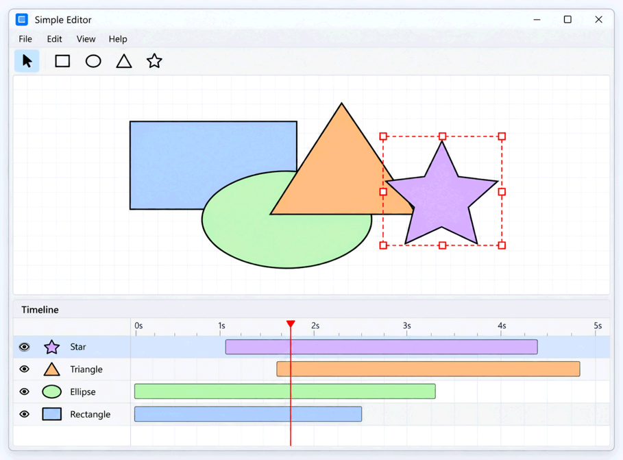

# ТО что нужно сделать
#### исправить TODO в проекте. перейти на паттер макро команды вместо просто команды для изменения размеров

IShapeVisitor.h
//TODO::стратегию сделать через геттер(не правильно, что я передаю и фигуру и её статегию. возможно служно в shape какой-то геттер стратегии)

#### `TimelineView` 

Timeline должен позволять:

- видеть фигуры документа *нужно иметь возможность видеть больше фигур. нужно добавить прокрутку, какже как и для CanvasList, также должен быть призрак,который демонстрирует что мы сейчас делаем(пример в CanvasList)*
изменять слои выделенных фигур (перемещение выделенных слоёв по вертикали)

---

#### несколько окон для одного документа

*currentFileName в EditorState рассинхронизирован
Окно A сохранило в foo.json, окно B не знает → Ctrl+S в B спросит имя. Не нарушение, но странно. Можно хранить currentFileName в SharedDocument (общее для окон документа). *

*лучше через boost::signals2 оповещать об изменениях. в примерах вроде был код(samples/10_grouping/editor_model.h)*

---

#### масштабирование Canvas(область где рисуются фигуры. при этом за границы изначального холста они выходить не должны)

*нужно либо закрасить основной холс, за границы которого не выходят фигуры, либо нарисовать его границу*
Добавьте возможность увеличивать и уменьшать масштаб Canvas например, при помощи клавиатуры,
 `Ctrl+Mouse Wheel` или кнопок управления масштабом.

*шталы отрезков времени не должны прерываться после сужения промежутка времени. они должны идти да правого края всегда*

## Группировка фигур и работа с составными объектами

### Группировка и множественное выделение

После Group:

- новая группа располагается **поверх остальных объектов** в порядке наложения (Z-order);

Если выбрано меньше двух объектов, Group не должна создавать новую группу или запись в истории.

### Автоматические тесты

Проверьте как минимум:

- Group двух **несоседних** фигур и сохранение их относительного Z-order;
- Undo Group с восстановлением исходных индексов;
- Ungroup с размещением детей на месте группы;
- Undo/Redo Ungroup;
- Move группы и корректное перемещение всех потомков;
- Resize группы из фигур разных типов, включая изменение расстояний между ними;
- Resize вложенной группы и Undo/Redo результата;
- последовательность Group → Move → Resize → Undo × 3 → Redo × 3;
- удаление группы с последующим Undo/Redo;
- отсутствие команд истории для действий без изменений;
- корректную загрузку/сохранение вложенной иерархии;
- отсутствие регрессий в операциях ЛР4.

*не все тесты есть*

---

## Бонусные задания

### вращение фигур и групп

Добавьте вращение отдельных фигур и групп мышью.

- Отдельная фигура вращается **вокруг собственного центра**.
- Группа вращается **вокруг центра группы**: поворачиваются и фигуры, и их положения относительно центра.
- Вложенные группы должны вращаться согласованно.
- У новой группы угол поворота равен **0°**, независимо от углов поворота её дочерних фигур.
- После Ungroup фигуры остаются на достигнутых позициях и с итоговыми значениями поворотов. Внешний вид документа не должен скачкообразно меняться.
- Вращение должно иметь Preview и попадать в историю как одна операция за один жест.
- Углы и геометрия сохраняются в документе и восстанавливаются после загрузки и Undo/Redo.

Обратите внимание: сочетание поворота и **непропорционального** масштабирования может потребовать матриц
аффинных преобразований (в частности, для представления сдвига/shear).
Если модель фигур поддерживает только положение, размеры и угол поворота, для **повёрнутых** фигур и групп
допускается ограничить Resize пропорциональным масштабированием, не отменяя обязательный Resize неповёрнутых групп.

### базовая поддержка групп в TimelineView

Если в ЛР4 реализован `TimelineView`, добавьте отображение групп в виде **одной полоски** на временной шкале.

- Начало её интервала равно **самому раннему началу** среди всех вложенных фигур.
- Конец — **самому позднему окончанию** среди них.
- Это охватывающий интервал: внутри него могут быть промежутки, когда отдельные фигуры неактивны.

Для получения этого бонуса необходим работающий TimelineView.
Его наличие могло быть обеспечено ещё в ЛР4 либо добавлено сейчас.

### изменение цвета группы

Добавьте возможность изменять цвет заливки и цвет обводки составной фигуры.

При изменении соответствующего свойства группы новый цвет должен применяться **ко всем фигурам внутри неё**,
включая фигуры во вложенных группах на любой глубине.

**Требования:**

- Цвет заливки и цвет обводки должны изменяться независимо друг от друга.
- Изменение цвета заливки группы не должно изменять цвет обводки дочерних фигур, и наоборот.

**Требования к архитектуре**

Групповое изменение цвета должно использовать общий механизм работы с фигурами, а не отдельные проверки всех конкретных типов фигур.

Не требуется хранить у группы собственный цвет или реализовывать наследование цветов. Допускается непосредственно изменять свойства дочерних фигур.

Если поддержка цвета отдельных фигур не была реализована в лабораторной работе №4, её необходимо добавить в рамках этого бонуса.

**Автоматические тесты**

Проверьте:

- Изменение цвета заливки и обводки независимо друг от друга.
- Применение цвета к фигурам во вложенных группах.
- Восстановление разных исходных цветов при Undo.
- Повторное применение цвета при Redo.
- Сохранение цветов после Ungroup и после загрузки документа.
- Отсутствие лишних команд истории, если цвет фактически не изменился.

---

