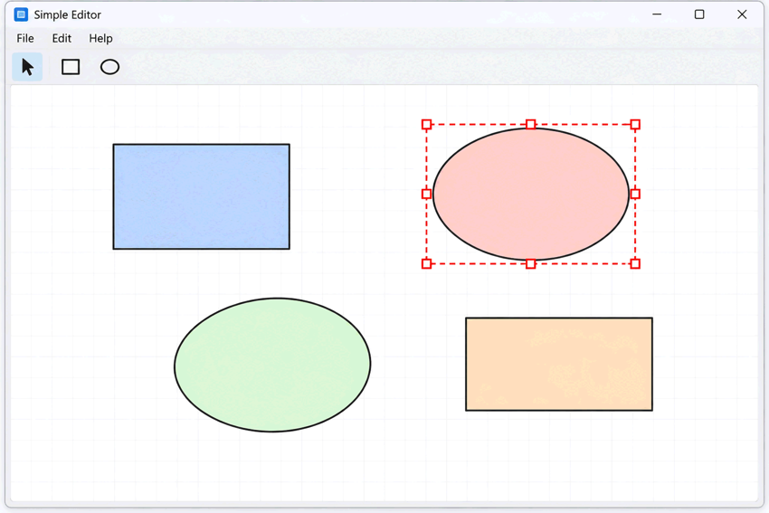

## Разработка графического редактора 

Разработать интерактивный графический редактор, позволяющий создавать композицию из геометрических фигур
 и редактировать её при помощи мыши и клавиатуры.

При проектировании приложения необходимо разделить:

- **модель документа** — состояние рисунка и поведение его объектов;
- **представление** — отображение документа пользователю;
- **логику взаимодействия** — интерпретацию действий пользователя и изменение модели.

Для организации приложения ИСПОЛЬЗУЕТСЯ архитектурный подход **MVC**
либо другую архитектуру с сопоставимым разделением ответственностей.

Конкретная GUI-библиотека и язык программирования не фиксируются, если иное не оговорено преподавателем.

### Документ

Документ представляет собой композицию из геометрических фигур.

Необходимо поддержать как минимум следующие виды фигур:

- прямоугольник;
- эллипс;
- треугольник.

Каждая фигура должна иметь:

- положение;
- размеры;
- геометрическую форму, соответствующую её типу.

Фигуры образуют упорядоченную последовательность слоёв.
Фигура, находящаяся выше остальных, должна отображаться поверх расположенных ниже фигур.

Состояние документа не должно содержать сведения, относящиеся только к текущему взаимодействию пользователя с интерфейсом,
например признак того, что фигура сейчас выделена.

---

### Окно редактора

Редактор должен предоставлять окно, содержащее:

- холст для отображения документа;
- панель инструментов и/или меню для выполнения доступных операций.

Размер и расположение элементов интерфейса выбираются самостоятельно.

При изменении размеров окна и при интерактивном редактировании фигур не должно возникать заметного мерцания изображения.
При необходимости используйте двойную буферизацию или соответствующий механизм выбранной GUI-библиотеки.

---

### Добавление фигур

Пользователь должен иметь возможность добавлять фигуры при помощи кнопок панели инструментов и/или пунктов меню.

При добавлении фигуры:

1. создаётся объект выбранного типа;
2. ему назначаются некоторые начальные размеры;
3. фигура помещается в позицию по умолчанию, например в центр холста;
4. новая фигура помещается на верхний слой.

Размеры и точное положение по умолчанию выбираются самостоятельно.

---

### Выделение фигур

Пользователь должен иметь возможность выделить фигуру щелчком мыши.

При определении фигуры под указателем необходимо учитывать её реальную геометрическую форму.

Например:

- прямоугольник можно выделить только при щелчке внутри прямоугольника;
- эллипс — только при щелчке внутри эллипса;
- треугольник — только при щелчке внутри треугольника.

Недостаточно проверять попадание только в ограничивающий прямоугольник фигуры.

Если в указанной точке находится несколько перекрывающихся фигур, должна выделяться фигура, расположенная выше остальных.

Щелчок по свободной области холста снимает текущее выделение.

В обязательной части одновременно может быть выделена не более чем одна фигура.

### Отображение выделения

Вокруг выделенной фигуры должна отображаться прямоугольная рамка выделения.

На рамке должны находиться маркеры, позволяющие изменять размеры фигуры.

Рамка выделения и её маркеры относятся к пользовательскому интерфейсу редактора и не являются частью самого документа.

Рамка выделения должна отображаться поверх всех фигур независимо от положения выделенной фигуры в порядке слоёв.

Даже если выделенная фигура частично или полностью перекрыта другой фигурой,
пользователь должен иметь возможность взаимодействовать с её рамкой и маркерами.

---

### Перемещение фигур

Выделенную фигуру можно перемещать мышью.

Начать перемещение можно:

- потянув за внутреннюю область фигуры;
- потянув за рамку выделения.

Во время перетаскивания фигура должна быть **привязана к курсору**.

Если пользователь начал перетаскивание, взаимное положение курсора и фигуры должно сохраняться на протяжении всего жеста.

Фигура не должна внезапно «прыгать» так, чтобы её центр или угол оказывались непосредственно под курсором.

Перемещение фигуры за пределы холста должно быть запрещено.

Если желаемое положение невозможно из-за границ холста,
допускается нарушение постоянства положения фигуры относительно курсора ровно настолько,
насколько это требуется для сохранения фигуры внутри холста.

---

### Изменение размеров

Размер выделенной фигуры должен изменяться при помощи маркеров рамки выделения.

Необходимо предусмотреть маркеры, позволяющие изменять размеры фигуры в основных направлениях.

При наведении курсора на маркер внешний вид курсора должен изменяться и подсказывать пользователю направление
возможного изменения размера — аналогично PowerPoint и другим графическим редакторам.

Изменение размеров не должно позволять фигуре выйти за пределы холста.

Необходимо самостоятельно определить допустимый минимальный размер фигуры
и корректно обработать попытки уменьшить её ниже этого размера.

---

### Удаление фигур

Выделенную фигуру можно удалить:

- клавишей `Delete`;
- кнопкой панели инструментов

После удаления фигуры не должно оставаться недействительных ссылок на неё в состоянии редактора.

---

### Разделение состояния документа и состояния редактирования

При проектировании необходимо различать как минимум:

#### Состояние документа

Например:

- набор фигур;
- геометрия фигур;
- порядок фигур по глубине.

#### Состояние текущей работы пользователя с документом

Например:

- выбранная фигура;
- состояние текущего перетаскивания;
- активный инструмент;
- временные данные, необходимые для обработки текущего жеста мышью.

Не следует добавлять в объект фигуры свойство наподобие:

```text
selected = true
```

только для того, чтобы отобразить рамку выделения.

Выделение характеризует текущее состояние редактора, а не саму фигуру как часть документа.

---

### Архитектура

Приложение должно быть построено с использованием **MVC, MVP, MVVM** либо другого архитектурного подхода,
обеспечивающего сопоставимое разделение ответственностей.

Архитектура должна обеспечивать следующие свойства.

#### Модель не зависит от GUI-библиотеки

Классы предметной модели не должны зависеть от конкретных классов используемой GUI-библиотеки без обоснованной необходимости.

Например, фигура предметной области не должна быть обязана наследоваться от графического примитива GUI-библиотеки
только ради возможности её нарисовать.

#### Логика взаимодействия отделена от отображения

Код, определяющий смысл пользовательского действия, не должен смешиваться с кодом непосредственного рисования фигур.

Например, решение о том, означает ли перемещение мыши:

- обычное движение курсора;
- перемещение фигуры;
- изменение её размера;

должно приниматься компонентом, отвечающим за пользовательское взаимодействие.

#### Представление не должно содержать предметную модель вместо модели

GUI-объекты не должны становиться единственным хранилищем состояния документа.

Приложение должно сохранять осмысленную модель рисунка независимо от конкретного способа его отображения.

---

### Hit testing

Проверка попадания точки в фигуру является частью поведения геометрической фигуры и должна учитывать реальную форму объекта.

Кроме проверки попадания в саму фигуру, интерфейс редактора должен уметь различать:

- попадание внутрь фигуры;
- попадание в рамку выделения;
- попадание в конкретный маркер изменения размера;
- попадание в пустую область холста.

Приоритет обработки этих областей должен позволять работать с рамкой выделения даже тогда,
когда выделенная фигура перекрыта другими объектами.

---

### Рекомендуемые сценарии для проверки

При сдаче лабораторной работы следует проверить как минимум следующие сценарии:

1. Создать несколько фигур разных типов.
2. Разместить фигуры так, чтобы они перекрывались.
3. Щёлкнуть по области пересечения и убедиться, что выбирается верхняя фигура.
4. Щёлкнуть внутри bounding box эллипса, но вне самого эллипса, и убедиться, что фигура не выбирается.
5. Выбрать фигуру и переместить её.
6. Начать drag не из центра фигуры и убедиться, что фигура не «прыгает» относительно курсора.
7. Попытаться перетащить фигуру за границу холста.
8. Изменить размеры фигуры за каждый из доступных маркеров.
9. Проверить изменение курсора над маркерами.
10. Попытаться изменить размер так, чтобы фигура вышла за пределы холста.
11. Перекрыть выделенную фигуру другой фигурой и убедиться, что рамка выделения остаётся доступной.
12. Удалить выделенную фигуру клавишей `Delete`.
13. Удалить выделенную фигуру через интерфейс.
14. Щёлкнуть по пустому месту и убедиться, что выделение снято.
15. Изменять размеры окна и активно перемещать фигуры, проверяя отсутствие заметного мерцания.

---

### Загрузка и сохранение документа

Редактор должен поддерживать сохранение документа в файл и последующую загрузку сохранённого документа.

Поддержите как минимум следующие операции:

- `Ctrl+S` — сохранить текущий документ;
- `Ctrl+O` — открыть документ из файла.
- `Ctrl+N` — создать новый документ.

Если документ ещё не имеет связанного с ним файла,
операция сохранения должна предложить пользователю выбрать имя и расположение файла.

При открытии документа пользователь выбирает файл при помощи стандартного диалога открытия файла
или аналогичного механизма выбранной GUI-библиотеки.

---

#### Что должно сохраняться

В файл должно сохраняться состояние самого документа.

Для каждой фигуры необходимо сохранить как минимум:

- тип фигуры;
- положение;
- размеры;
- порядок расположения по глубине.

Если в редакторе появятся дополнительные свойства фигур, относящиеся к самому документу, они также должны сохраняться.

После загрузки документа его содержимое должно визуально и логически соответствовать состоянию на момент сохранения.

В частности, должны восстановиться:

- все фигуры;
- их типы;
- положение и размеры;
- порядок наложения.

---

#### Что не должно сохраняться

Не следует сохранять состояние, относящееся только к текущей работе пользователя с документом.

Например, в файл не должны обязательно попадать:

- текущая выделенная фигура;
- состояние drag или resize;
- положение курсора мыши;
- hover-состояние;
- активный маркер изменения размера;
- другие временные данные пользовательского взаимодействия.

После загрузки документа допустимо, чтобы ни одна фигура не была выделена.

Таким образом, формат файла должен отражать прежде всего **состояние документа**, а не состояние пользовательского интерфейса.

---

#### Формат файла

Формат хранения документа выбирается самостоятельно.

Допускается использовать:

- JSON;
- XML;
- собственный текстовый формат;
- другой подходящий формат.

Формат должен позволять однозначно восстановить документ.

Например, при использовании текстового представления для каждой фигуры
необходимо каким-либо образом хранить её тип и необходимые параметры.

Конкретная структура файла не задаётся условием и является частью проектного решения.

---

#### Обработка ошибок

Программа не должна аварийно завершаться при попытке открыть некорректный файл.

Необходимо корректно обработать как минимум следующие ситуации:

- файл не существует или недоступен для чтения;
- содержимое файла имеет неверный формат;
- указанный тип фигуры не поддерживается;
- отсутствуют обязательные данные фигуры;
- значения параметров имеют недопустимый формат.

Пользователю должно быть показано понятное сообщение об ошибке.

Если загрузить документ не удалось, текущий документ не должен оказаться частично заменён данными из некорректного файла.

---

#### Атомарность загрузки

При чтении документа рекомендуется сначала полностью построить новое состояние документа и убедиться, что файл корректен.

Только после успешной загрузки новое состояние должно заменить текущее.

Например, нежелателен такой сценарий:

1. старый документ очищается;
2. из файла успешно загружаются первые несколько фигур;
3. при чтении следующей фигуры обнаруживается ошибка;
4. пользователь остаётся с частично загруженным документом.

После неудачной загрузки приложение должно по возможности сохранить прежнее корректное состояние.

---

#### Архитектурные требования

Код загрузки и сохранения не должен зависеть от деталей пользовательского интерфейса без необходимости.

В частности, сама модель документа не должна быть обязана работать с:

- диалогами выбора файла;
- кнопками меню;
- клавиатурными сочетаниями;
- конкретными классами GUI-библиотеки.

GUI отвечает за получение команды пользователя и выбор файла.

Механизм сохранения отвечает за преобразование состояния документа в выбранное файловое представление.

Механизм загрузки выполняет обратное преобразование — из файлового представления в состояние документа.

Не следует добавлять в классы фигур код работы с диалогами открытия и сохранения файлов.

---

#### Сценарии для проверки

При сдаче работы проверьте как минимум следующие сценарии:

1. Создать несколько фигур разных типов.
2. Изменить их положение и размеры.
3. Расположить фигуры так, чтобы был заметен их z-order.
4. Сохранить документ.
5. Закрыть или очистить исходный документ.
6. Загрузить сохранённый файл.
7. Убедиться, что все фигуры восстановились с правильными типами, размерами, координатами и порядком.
8. Выделить фигуру, сохранить документ и убедиться, что после загрузки сохранение выделения не является обязательным.
9. Попытаться открыть файл неверного формата.
10. Убедиться, что после ошибки текущее корректное состояние документа не было частично уничтожено.

### Бонусные задания

Бонусные задания можно выполнять независимо друг от друга, если конкретный бонус не требует возможностей другого.

---

#### Создание фигур непосредственно на холсте 

Добавьте инструменты создания фигур.

После выбора инструмента `Rectangle`, `Ellipse` или `Triangle`
пользователь должен иметь возможность создать фигуру непосредственно на холсте:

1. нажать кнопку мыши в точке начала;
2. перемещать курсор, задавая размеры создаваемой фигуры;
3. видеть предварительный результат;
4. отпустить кнопку мыши и завершить создание.

Во время создания новая фигура должна изменять размер вместе с перемещением курсора.

Необходимо корректно обрабатывать попытку создания фигуры около границы холста.

Предусмотрите возможность отменить незавершённое создание, например клавишей `Esc`.

Обратите внимание, что после появления этого режима одинаковые события мыши могут иметь различный смысл.

Например, `MouseMoved` может означать:

- обычное движение курсора;
- drag существующей фигуры;
- resize;
- создание новой фигуры.

Архитектура должна позволять различать эти режимы
без превращения обработчика событий GUI в одну большую цепочку несвязанных действий.

---

#### Список фигур и изменение порядка слоёв

Добавьте в окно редактора ещё одно представление документа — **панель со списком фигур**.

В списке должна присутствовать отдельная строка для каждой фигуры документа.

Строка должна содержать как минимум небольшую иконку или миниатюрное изображение, позволяющее визуально определить тип фигуры.

Порядок элементов списка должен соответствовать порядку фигур по глубине.

##### Синхронизация выделения

Выделение должно быть общим для Canvas и списка фигур.

Если пользователь выделяет фигуру на холсте, соответствующая строка должна выделяться в списке.

Если пользователь выбирает строку в списке, соответствующая фигура должна выделяться на холсте.

##### Добавление и удаление

При добавлении фигуры в документ соответствующий элемент должен появляться в списке.

При удалении фигуры элемент должен исчезать.

Добавление нового представления документа не должно требовать добавлять специальные 
вызовы его обновления во все места программы, которые могут изменить документ.

Рекомендуется использовать механизм уведомлений, событий, сигналов/слотов или другой вариант реализации паттерна **Observer**.

##### Изменение z-order

Пользователь должен иметь возможность изменить порядок фигур, перетаскивая строки списка вверх и вниз.

После изменения порядка:

- соответствующим образом изменяется порядок фигур в документе;
- Canvas отображает фигуры в новом порядке;
- hit testing учитывает новый порядок.

##### Прокрутка

Фигур может быть больше, чем одновременно помещается в панели.

В этом случае список должен поддерживать вертикальную прокрутку.

---

#### Бонус 3. Несколько документов 

Добавьте поддержку одновременной работы с несколькими документами.

Каждый документ должен открываться в отдельном окне.

Поддержите как минимум:

- `Ctrl+N` — создать новый документ и открыть его в новом окне;
- `Ctrl+O` — открыть существующий документ в новом окне.

Каждое окно работает со своим независимым документом.

Например:

- фигуры одного документа не должны появляться в другом;
- выделение в одном окне не должно влиять на другое окно;
- drag или resize в одном окне не должны менять другой документ.

Закрытие одного окна не должно завершать приложение, если остаются другие открытые окна.

Архитектура приложения не должна предполагать существование ровно одного глобального документа или одного глобального окна.

Организацию создания окон, хранения документов и управления временем их жизни разработайте самостоятельно.

Формат хранения документа также выбирается самостоятельно.

---

#### Бонус 4. Множественное выделение 

Добавьте возможность одновременно выделять несколько фигур.

Например, при помощи `Ctrl+Click` или `Shift+Click` пользователь должен иметь возможность:

- добавить фигуру к текущему выделению;
- исключить фигуру из текущего выделения.

Обычный щелчок без модификатора должен создавать новое одиночное выделение.

Щелчок по пустому месту должен снимать выделение.

Все выделенные фигуры должны иметь визуальное обозначение выделения.

##### Совместное перемещение

Если пользователь начинает перетаскивать одну из выделенных фигур, должна перемещаться вся выделенная группа.

При этом:

- взаимное расположение фигур сохраняется;
- ни одна из перемещаемых фигур не должна выйти за пределы холста;
- все фигуры группы должны перемещаться на одинаковое расстояние.

##### Совместное изменение размеров

При изменении размеров одной фигуры должны пропорционально изменяться размеры других выделенных фигур.

При этом:

- взаимное расположение фигур сохраняется;
- ни одна из фигур, размеры которых изменяются не должна выйти за пределы холста;
- все фигуры группы должны масштабироваться одинаково относительно своих оригинальных размеров.

##### Удаление

Нажатие `Delete` должно удалять все выделенные фигуры.

Обратите внимание, что множественное выделение — это не только замена одного указателя на контейнер указателей.

Необходимо продумать:

- кому принадлежит набор выделенных объектов;
- что происходит с выделением при удалении фигуры;
- как View отображает несколько выделенных объектов;
- как Controller интерпретирует drag одной из выбранных фигур;
- должна ли Model предоставлять отдельную операцию для перемещения нескольких фигур.

Изменение размера группы фигур в этот бонус не входит и может быть реализовано дополнительно.

## Реализация механизма Undo/Redo — **100 баллов**

Возьмите за основу графический редактор, разработанный в лабораторной работе №3.



Вся обязательная функциональность лабораторной работы №3 должна сохраниться.
В частности, приложение должно по-прежнему уметь создавать, загружать, сохранять и отображать документы,
выбирать фигуры и выполнять предусмотренные предыдущей работой операции редактирования.

Расширьте редактор следующими возможностями:

- добавление фигур;
- удаление фигур;
- перемещение фигур мышью;
- изменение размеров фигур мышью;
- Undo;
- Redo.

Все перечисленные операции, изменяющие документ, должны поддерживать Undo и Redo.

Способ добавления фигуры в основной части задания может остаться таким же, каким он был в лабораторной работе №3.
Создание фигуры непосредственным протягиванием мыши по Canvas является отдельным бонусным заданием.

---

### Добавление и удаление фигур

Пользователь должен иметь возможность добавить новую фигуру в документ и удалить выбранную фигуру.

Добавление одной фигуры считается одной операцией редактирования:

```text
Add
 ↓
Undo
 ↓
фигура исчезает
 ↓
Redo
 ↓
фигура появляется снова
```

Аналогично, удаление одной фигуры должно отменяться и повторяться как одна операция.

После Undo удаления фигура должна восстанавливаться в том же состоянии и в том же месте среди остальных фигур,
в котором она находилась до удаления.

После удаления фигуры в приложении не должно оставаться невалидных ссылок на неё, в том числе в состоянии выделения.

**Должно поддерживаться не менее 5 различных видов фигур**.

---

### Перемещение фигур

Выбранную фигуру можно перемещать при помощи мыши.

Одно перемещение от нажатия кнопки мыши до её отпускания считается **одним пользовательским действием**
независимо от числа событий перемещения мыши:

```text
MousePressed
MouseMoved
MouseMoved
MouseMoved
...
MouseReleased
        ↓
одна операция в истории
```

Во время перемещения приложение должно отображать промежуточное положение фигуры.

Undo должен восстанавливать положение фигуры до начала drag, а Redo — положение после его завершения.

Если положение фигуры фактически не изменилось, новая операция в истории создаваться не должна.

---

### Изменение размеров фигур

Для выбранной фигуры должна быть предусмотрена возможность изменить её размеры мышью.
Конкретное визуальное представление элементов resize — например, маркеры на рамке выделения — выбирается самостоятельно.

Во время resize пользователь должен видеть промежуточный результат.

Вся операция от начала resize до её завершения должна попадать в историю как **одно действие**.

Undo должен восстанавливать размеры и положение фигуры до начала операции, а Redo — повторно применять итоговый размер.

Фигура не должна в результате resize приобретать недопустимые размеры.

---

### Preview и Commit

Событие GUI не обязательно является отдельным пользовательским действием.

Во время drag или resize может происходить множество промежуточных обновлений:

```text
Begin
 ↓
Update
 ↓
Update
 ↓
Update
 ↓
Commit
```

В историю должно попадать только завершённое действие.

Промежуточное состояние, которое пользователь видит во время операции,
не обязано немедленно становиться зафиксированным состоянием документа.

Архитектура должна позволять прервать незавершённую операцию без появления лишних записей в Undo/Redo-истории.

---

### Undo и Redo

Реализуйте отмену и повторное выполнение операций редактирования.

Рекомендую ознакомиться с [примером](../../samples/vector-editor/gfx_editor/08_undo/),
иллюстрирующим реализацию базовых возможностей Undo/Redo.

Для приложения должны быть предусмотрены горячие клавиши:

| Действие | Горячая клавиша |
|---|---|
| Undo | `Ctrl+Z` |
| Redo | `Ctrl+Y` или `Ctrl+Shift+Z` |

Допускается использовать другие комбинации клавиш, если это соответствует соглашениям выбранной платформы.

История должна вести себя следующим образом:

```text
A → B → C
        ↑
       Undo

A → B

затем выполняется новое действие D

A → B → D
```

После выполнения `D` действие `C` больше не должно быть доступно через Redo.

Повторный вызов Undo в начале истории и Redo в её конце не должен приводить к ошибке.

Действия, которые фактически не изменили документ, не должны засорять историю.

---

### Гранулярность истории

История должна хранить **пользовательские действия**, а не низкоуровневые события интерфейса.

Минимально должны выполняться следующие правила:

| Действие пользователя | Число операций в истории |
|---|---:|
| Добавить одну фигуру | 1 |
| Удалить одну фигуру | 1 |
| Один drag перемещения | 1 |
| Один drag resize | 1 |

Не допускается создание отдельной команды для каждого `MouseMoved`.

---

### Загрузка и сохранение документа

Функциональность загрузки и сохранения, реализованная в лабораторной работе №3, должна сохраниться.

В файл должно сохраняться **состояние документа**, но не история его редактирования.

После открытия документа:

- загруженное состояние становится начальным состоянием документа;
- Undo/Redo-история должна быть пустой;
- последующие изменения должны попадать в новую историю.

Операция сохранения не должна создавать запись в Undo/Redo-истории и не должна очищать существующую историю.

Сохраняться должно только зафиксированное состояние документа.
Временное состояние незавершённого drag/resize, выделение фигур,
масштаб View и другое состояние интерфейса не должны случайно попадать в файл.

Если в рамках бонусных заданий у фигур появятся новые свойства, являющиеся частью документа,
например цвет или временной интервал, они также должны корректно сохраняться и загружаться.

---

### Избавьтесь от `dynamic_cast`

В лабораторной работе №3 для определения конкретного типа фигуры мог использоваться `dynamic_cast`.
В этой работе такой способ диспетчеризации необходимо заменить.

Типоспецифичные операции, например Rendering и Serialization,
не должны определять тип фигуры при помощи цепочек `dynamic_cast`, `typeid` или аналогичных ручных проверок типа.

Для C++ используйте **double dispatch** и Visitor:

```cpp
class IShape
{
public:
    virtual void Accept(IShapeVisitor& visitor) const = 0;

    // ...
};
```

Конкретные операции должны реализовывать соответствующий Visitor.

Обычные полиморфные операции фигур, такие как `GetBounds`, `HitTest`,
перемещение или изменение размера, не требуется искусственно переносить в Visitor.

При выполнении лабораторной работы на другом языке программирования используйте идиоматичный
для выбранного языка механизм диспетчеризации, позволяющий избежать ручного определения динамического типа объекта.

---

### Требования к архитектуре

История изменений должна быть отдельной ответственностью и не должна находиться внутри View.

Операции, сохраняемые в истории, должны содержать достаточно информации,
чтобы выполнить и отменить соответствующее изменение документа.

Для C++ естественным вариантом является интерфейс наподобие:

```cpp
class ICommand
{
public:
    virtual ~ICommand() = default;

    virtual void Execute() = 0;
    virtual void Unexecute() = 0;
};
```

Конкретные имена классов, устройство истории и структура слоёв редактора выбираются самостоятельно.
Воспроизводить архитектуру из лекции буквально не требуется.

При проектировании обращайте внимание на следующие вопросы:

- кому принадлежит Undo/Redo-история;
- как связан её жизненный цикл с жизненным циклом документа;
- где хранится состояние незавершённого interaction;
- кто формирует завершённую команду;
- какие объекты должны знать о механизме Undo/Redo;
- каким образом View узнают об изменении документа после Execute, Undo и Redo.

Не создавайте специальных путей обновления интерфейса только для Undo или Redo,
если того же результата можно добиться через обычный механизм распространения изменений модели.

---

### Автоматические тесты

Логику Undo/Redo, не зависящую от GUI, необходимо покрыть автоматическими тестами.

В частности, следует проверить:

- последовательное Undo нескольких операций;
- последовательное Redo;
- невозможность Redo после выполнения нового действия вслед за Undo;
- корректное восстановление состояния после Add/Delete;
- корректное восстановление положения после Move;
- корректное восстановление состояния после Resize;
- корректное поведение на границах истории;
- сохранение порядка фигур после Delete → Undo;
- отсутствие регрессий в загрузке и сохранении документа.

GUI не обязательно полностью покрывать автоматическими тестами,
однако значимая логика редактирования не должна быть доступна для проверки только через ручное взаимодействие с окном.

#### изменение цвета фигур

Добавьте возможность изменять внешний вид выбранной фигуры.

Пользователь должен независимо задавать:

- цвет заливки;
- цвет обводки.

Изменение цвета должно быть обратимой операцией.

Если реализовано множественное выделение, изменение цвета применяется
ко всем выбранным фигурам как одна пользовательская операция.

Цвет является частью документа и должен сохраняться в файл.

---

#### создание фигур мышью 

Добавьте инструменты создания фигур непосредственно на Canvas.

Пользователь выбирает тип фигуры на панели инструментов, нажимает кнопку мыши в начальной точке,
перемещает курсор с зажатой кнопкой и отпускает кнопку в конечной точке.

Во время drag должен отображаться Preview создаваемой фигуры.

После отпускания мыши должна появиться одна фигура, положение и размеры которой определяются начальной и конечной точками.

Вся операция создания должна попадать в историю как одна команда.

Если итоговая ширина или высота равна нулю, фигура не должна создаваться, а история не должна изменяться.

---

#### множественное выделение 

Добавьте возможность одновременно выделять несколько фигур.

Способ добавления и удаления фигур из выделения выбирается самостоятельно;
рекомендуется использовать привычные модификаторы клавиатуры вроде `Ctrl` или `Shift`.

Для множественного выделения должны поддерживаться как минимум:

- совместное перемещение;
- удаление всех выбранных фигур.

Перемещение нескольких фигур за один drag считается одной операцией и отменяется одним Undo.

Удаление нескольких выделенных фигур также считается одной операцией и должно полностью восстанавливаться одним Undo.

Относительное расположение фигур при совместном перемещении должно сохраняться.

Групповой resize в рамках данного бонуса не требуется.

---

#### многодокументное редактирование

Добавьте возможность одновременно работать с несколькими документами.

Создание нового документа и открытие существующего документа должны создавать отдельный
редактируемый документ со своей историей изменений.

Каждый документ должен иметь: собственное состояние + собственную Undo/Redo-историю.

Undo в одном документе не должен влиять на другой.

Этот бонус не должен конфликтовать с возможностью открыть **один документ в нескольких окнах**.

Например, приложение может находиться в следующем состоянии:

```text
Document A
├── Window A1
├── Window A2
└── History A

Document B
├── Window B1
└── History B
```

Окна `A1` и `A2` разделяют документ и историю, но не разделяют их с окном `B1`.

Документ должен существовать до тех пор, пока открыто хотя бы одно связанное с ним окно.
После закрытия последнего окна документ и его история должны быть уничтожены.

---


