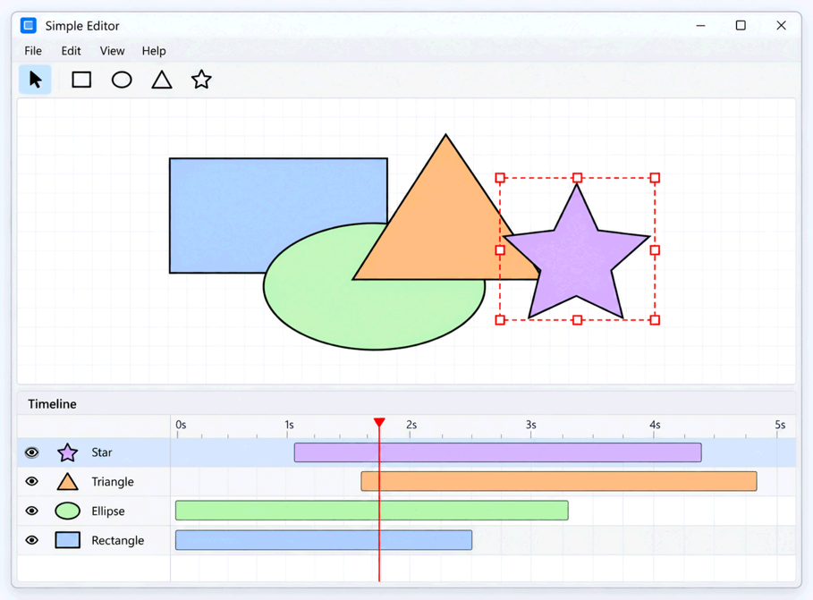

# ТО что нужно сделать
#### исправить TODO в проекте. перейти на паттер макро команды вместо просто команды для изменения размеров

MoveShapesCommand.cpp
// TODO:делать через паттерн макро команды

EditorController.cpp
//TODO: лучше через стате(EditorState) делать и перемещение тоже(сейчас перемещение через паттерн комады, а изменение размеров фигур через макро команды)

IShapeVisitor.h
//TODO::стратегию сделать через геттер(не правильно, что я передаю и фигуру и её статегию. возможно служно в shape какой-то геттер стратегии)

#### `TimelineView` 

Добавьте в окно редактора второе представление документа — `TimelineView`.



Timeline должен позволять:

- видеть фигуры документа;
- выбирать фигуру;
- выбирать текущий момент времени (перемещение фигуры по горизонтали).
- изменять слои выделенных фигур (перемещение выделенных слоёв по вертикали)

Выделение в Canvas и Timeline одного окна должно быть синхронизировано:

```text
выделили фигуру на Canvas
          ↓
она выделена на Timeline

выделили фигуру на Timeline
          ↓
она выделена на Canvas
```

Canvas и Timeline должны использовать общее состояние редактирования окна,
а не поддерживать независимые копии selection.

Изменение текущего момента времени относится к состоянию окна и не должно попадать в Undo/Redo-историю документа.

Если временная модель редактора предполагает редактирование свойств фигур на Timeline,
такие изменения документа должны выполняться через Undo/Redo на общих основаниях.

---

#### несколько окон для одного документа

Добавьте возможность открыть дополнительное окно для уже открытого документа.
Например, для этого можно предусмотреть отдельную горячую клавишу или пункт меню.

Окна одного документа должны совместно использовать:

- одно состояние документа;
- одну Undo/Redo-историю.

При этом состояние конкретного окна должно оставаться независимым.
В частности, разные окна могут иметь разные selection и эффективное состояние Preview.

Committed-изменение, выполненное в одном окне, должно автоматически отображаться во всех остальных окнах того же документа.

Undo или Redo можно вызвать из любого окна. Операция изменяет общий документ.

После Undo/Redo выделение **в активном окне** должно переключаться на фигуру или фигуры,
к которым относилась отменённая либо повторённая операция.

Selection остальных окон не следует без необходимости менять.
Если выбранная в другом окне фигура перестала существовать,
окно обязано корректно обработать эту ситуацию и не хранить невалидную ссылку.

Если одновременно реализован `TimelineView`,
разные окна одного документа должны иметь возможность выбирать **разные текущие моменты времени**.

---

#### Бонус: масштабирование Canvas(область где рисуются фигуры. при этом за границы изначального холста они выходить не должны)

Добавьте возможность увеличивать и уменьшать масштаб Canvas например, при помощи клавиатуры,
 `Ctrl+Mouse Wheel` или кнопок управления масштабом.

Масштаб относится к View и:

- не является состоянием документа;
- не попадает в Undo/Redo;
- не сохраняется как часть Drawing.

Если реализована многооконность, каждое окно должно иметь собственный масштаб Canvas.

---

#### масштабирование Timeline

При реализованном `TimelineView` добавьте возможность управлять масштабом временной шкалы.

Масштаб Timeline относится к конкретному View.

При работе одного документа в нескольких окнах каждое окно должно иметь возможность использовать собственный масштаб Timeline.

---

#### Совместная работа бонусов

Если реализовано несколько бонусных возможностей, они должны корректно работать вместе.

В частности:

```text
Multiple selection + Delete
→ все выбранные фигуры удаляются одной операцией

Multiple selection + Color
→ цвет всех выбранных фигур меняется одной операцией

Timeline + Multiple windows
→ в разных окнах можно выбрать разные моменты времени

Canvas zoom + Multiple windows
→ каждое окно имеет свой масштаб Canvas

Timeline zoom + Multiple windows
→ каждое окно имеет свой масштаб Timeline

Multiple documents + Multiple windows
→ окна одного документа разделяют историю,
  разные документы имеют разные истории
```

Реализация бонуса не должна нарушать обязательную функциональность или уже реализованные бонусы.

## Группировка фигур и работа с составными объектами

Возьмите за основу графический редактор, разработанный в лабораторной работе №4.

**Вся обязательная функциональность лабораторной работы №4 должна сохраниться.**
Редактор должен по-прежнему поддерживать не менее пяти видов фигур, добавление и удаление,
перемещение и изменение размеров обычных фигур, Preview/Commit, Undo/Redo, загрузку и сохранение документа.

Если вы уже реализовали бонусы лабораторной работы №4, новая функциональность не должна нарушать их работу.

Добавьте следующие возможности:

- выделение нескольких фигур для группировки;
- создание групп, в том числе вложенных;
- выбор и перемещение группы как одного объекта;
- **изменение размеров группы с масштабированием всех её потомков**;
- разгруппировку;
- Undo/Redo всех перечисленных операций, изменяющих документ;
- сохранение и загрузку иерархии фигур.

### Группировка и множественное выделение

Пользователь должен иметь возможность выбрать несколько объектов верхнего уровня рисунка
и объединить их в группу (Group). Рекомендуется использовать `Ctrl+G` либо привычное для выбранной платформы сочетание клавиш.

Для группировки необходимо поддержать **множественное выделение**,
\например через `Ctrl+Click` или `Shift+Click`. Если множественное выделение было реализовано в бонусе
лабораторной работы №4, используйте уже существующий механизм.

После Group:

- создаётся один составной объект, содержащий все выбранные фигуры;
- группа становится самостоятельным объектом рисунка и выделяется;
- новая группа располагается **поверх остальных объектов** в порядке наложения (Z-order);
- дочерние фигуры сохраняют свой **относительный** Z-order;
- исходные объекты не должны заменяться копиями, если это нарушило бы уже существующие команды истории.

Пример:

```text
До Group:         A B C D E
Выделены:           B   D
После Group(B,D): A C E G(B,D)
```

Если выбрано меньше двух объектов, Group не должна создавать новую группу или запись в истории.

### Составная фигура и вложенные группы

Группа должна поддерживать тот же общий контракт работы с фигурами, что и отдельные геометрические примитивы.

В частности, группа должна позволять:

- определять свои границы по содержимому;
- определять попадание курсора по дочерним фигурам;
- отображать всех детей с соблюдением Z-order;
- перемещать и масштабировать всё содержимое;
- содержать как обычные фигуры, так и другие группы.

Щелчок по любой фигуре внутри **невыделенной группы** должен выделять всю группу верхнего уровня.
Выбор отдельных дочерних фигур **без разгруппировки** в обязательную часть не входит.

Глубина вложенности групп не должна быть искусственно ограничена одним уровнем.

```text
Drawing
├── Rectangle A
└── Group G1
    ├── Ellipse B
    └── Group G2
        ├── Rectangle C
        └── Triangle D
```

Пустое пространство между дочерними фигурами внутри общего охватывающего прямоугольника
\не обязано считаться попаданием в группу; рекомендуется проверять попадание в реальные дочерние фигуры.

### Добавление и удаление фигур

Возможности добавления и удаления обычных фигур из ЛР4 должны сохраниться.

Удаление выделенной группы должно удалять её **вместе со всем содержимым**, как один объект верхнего уровня.
Undo удаления должен восстанавливать группу, вложенность, геометрию и её прежний Z-order; Redo — снова удалять её.

После удаления или изменения структуры не должно оставаться невалидных ссылок в выделении,
Preview или других состояниях редактора.

### Перемещение групп

Выделенную группу можно перемещать мышью так же, как обычную фигуру.

- Все дочерние фигуры, включая вложенные группы, перемещаются на одно согласованное смещение.
- Их взаимное расположение и размеры не изменяются.
- Во время drag отображается Preview.
- Одно перемещение группы — одна операция в истории.
- Undo/Redo восстанавливают положение всей композиции.

Перемещение одной группы не должно приводить к созданию отдельной команды для каждой дочерней фигуры.

### Изменение размеров групп

**Resize составной фигуры — обязательное требование.**

Пользователь должен иметь возможность изменить размеры выделенной группы мышью,
например с помощью маркеров рамки выделения. Способ организации управляющих элементов выбирается самостоятельно.

При Resize должны изменяться:

- размеры дочерних фигур;
- координаты дочерних фигур относительно границ группы;
- содержимое вложенных групп на любой глубине.

**Недостаточно** изменить только рамку группы или только размеры детей, оставив расстояния между ними прежними.

При изменении охватывающего прямоугольника группы с `(x, y, width, height)` до `(x', y', width', height')`
можно использовать относительное преобразование:

```text
sx = width' / width
sy = height' / height

childX' = x' + (childX - x) * sx
childY' = y' + (childY - y) * sy
```

Аналогичным образом преобразуются размеры и прочие геометрические параметры дочерних фигур.
Это пример математического подхода, а не требование к внутренней реализации.

- Во время resize должен отображаться Preview всей группы.
- Вся операция от начала до завершения drag считается **одним пользовательским действием**.
- Undo восстанавливает исходную геометрию всей группы; Redo повторяет итоговую.
- После преобразования фигуры не должны получать недопустимые размеры, а вычисления не должны приводить к делению на ноль.

Корректность Resize необходимо проверить как минимум для группы из разных типов фигур и для группы, содержащей другую группу.

### Разгруппировка

Добавьте операцию Ungroup. Рекомендуемое сочетание клавиш — `Ctrl+Shift+G`.

В обязательной части достаточно поддержать разгруппировку **одной выбранной группы верхнего уровня**.

После Ungroup:

- объект группы исчезает из Drawing;
- его непосредственные дети становятся самостоятельными элементами на месте группы;
- относительный порядок детей сохраняется;
- дети сохраняют свои **текущие** координаты, размеры и другие свойства;
- бывшие дочерние объекты становятся выделенными.

Ungroup не должна рекурсивно уничтожать вложенные группы: если внутри разгруппировываемой группы есть другая группа, она остаётся группой.

**Ungroup и Undo Group — разные операции:**

```text
Исходно:             A B C D E
После Group(B, D):   A C E G(B, D)

Undo Group:          A B C D E
Ungroup(G):          A C E B D
```

Undo Group восстанавливает **исторические позиции** фигур. Ungroup размещает детей на **текущем месте группы**.

Если выбрана обычная фигура, несколько объектов или отсутствует выделение,
некорректный Ungroup не должен менять документ или историю.

### Preview и Commit

Как и в ЛР4, события GUI не обязательно являются самостоятельными действиями пользователя.

```text
Begin Move / Resize
       ↓
Update Preview
       ↓
Update Preview
       ↓
Commit → одна операция в истории
```

- Во время перемещения и Resize группы пользователь должен видеть промежуточный результат для **всех** дочерних фигур.
- Незавершённую операцию должно быть возможно отменить, вернув исходное состояние без новой записи в историю.
- В историю попадает только окончательно зафиксированное изменение.
- Если геометрия фактически не изменилась, новая команда не создаётся.

### Undo и Redo

Group, Ungroup, Move группы, Resize группы и Delete группы должны поддерживать Undo/Redo.
Используйте клавиши, уже предусмотренные в ЛР4 (`Ctrl+Z`, `Ctrl+Y` или `Ctrl+Shift+Z`).

Новые операции должны интегрироваться в **существующую историю документа**, а не создавать отдельную историю групп.

Обеспечьте корректность последовательностей вида:

```text
Group(B, D)
    ↓
Move(G)
    ↓
Resize(G)
    ↓
Undo Resize
    ↓
Undo Move
    ↓
Undo Group
    ↓
Redo Group
    ↓
Redo Move
    ↓
Redo Resize
```

После Undo группировки ранее выполненные команды над дочерними фигурами должны оставаться корректными.
После Redo группировки команды над самой группой должны снова работать.

Выполнение нового действия после Undo должно, как и раньше, отменять доступность старой ветки Redo.
Вызовы Undo/Redo на границах истории не должны приводить к ошибкам.

### Гранулярность истории

История хранит **завершённые пользовательские действия**, а не низкоуровневые изменения отдельных фигур.

| Действие пользователя | Число операций в истории |
|---|---:|
| Group нескольких фигур | 1 |
| Ungroup одной группы | 1 |
| Один drag перемещения группы | 1 |
| Один drag изменения размеров группы | 1 |
| Удаление группы целиком | 1 |

Нельзя добавлять отдельную команду истории для каждого дочернего объекта или события `MouseMoved`.

### Загрузка и сохранение документа

Расширьте формат документа, чтобы он сохранял не только отдельные фигуры, но и **иерархию групп произвольной глубины**.

После сохранения и последующей загрузки должны сохраняться:

- типы и свойства всех фигур;
- состав групп и вложенность;
- размеры и координаты дочерних фигур после Move/Resize;
- относительный порядок объектов на каждом уровне.

```text
Drawing
├── Rectangle
├── Group
│   ├── Ellipse
│   └── Group
│       ├── Triangle
│       └── Rectangle
└── Ellipse
```

Документы без групп, которые умел открывать редактор после ЛР4, должны по-прежнему загружаться.

Как и раньше:

- В файл сохраняется **состояние документа**, но не Undo/Redo-история.
- После открытия история должна быть пустой.
- Выделение, Preview, масштаб View и прочее временное состояние интерфейса не сохраняются как часть Drawing.
- Сохранение не добавляет команду в историю и не сбрасывает существующую историю.

После загрузки документа с вложенными группами их должно быть возможно перемещать,
масштабировать, разгруппировывать и отменять новые действия.

### Избавьтесь от `dynamic_cast`

В ЛР4 типоспецифичные операции Rendering и Serialization должны были отказаться от цепочек `dynamic_cast`,
`typeid` и аналогичных проверок типа.

Появление `GroupShape` не должно приводить к возврату такой диспетчеризации.

Для C++ расширьте существующий протокол Visitor (например, `Visit(const GroupShape&)`)
и соответствующие реализации обработки фигур.
Рекурсивная отрисовка и сериализация должны корректно работать с вложенными группами.

Обычные полиморфные операции (`GetBounds`, `HitTest`, Move, Resize) не требуется искусственно переносить в Visitor.

При выполнении работы на другом языке программирования используйте идиоматичный для этого языка способ полиморфной
диспетчеризации без ручных цепочек проверок конкретных типов.

### Требования к архитектуре

Приложение должно реализовывать **идею Composite**: отдельная фигура и группа имеют общий способ использования,
а группа может содержать другие компоненты того же интерфейса.

Конкретные классы, имена методов, формат сериализации и способы хранения объектов выбираются самостоятельно.
Копировать архитектуру лекционного прототипа буквально не требуется.

При проектировании необходимо продумать:

- кто владеет фигурами до и после Group/Ungroup;
- как сохраняется идентичность объектов, на которые могут ссылаться ранее созданные команды;
- кто вычисляет геометрию и выполняет Resize вложенных групп;
- как изменения дочерней фигуры доходят до Drawing и представлений;
- где хранится временное состояние Preview;
- как обновляется выделение при изменении структуры;
- как операции Group/Ungroup интегрируются с общей историей;
- где находится общий механизм хранения фигур, если он используется несколькими классами.

Если после добавления группы возникло дублирование между Drawing и составными фигурами, устраните его.
**Создавать класс с конкретным именем `ShapeCollection` не обязательно**;
повторное использование реализации через композицию часто предпочтительнее искусственного общего базового класса.

Группа не должна превращать Domain Model в код, зависимый от GUI-библиотеки.

Если в ЛР4 были реализованы несколько окон одного документа, каждое окно должно корректно реагировать
на структурные изменения общего Drawing. Не храните висячие ссылки на исчезнувшие объекты.
Сохраняйте правила выделения в активном окне после Undo/Redo, предусмотренные предыдущей работой;
выделение остальных окон не следует изменять без необходимости.

### Автоматические тесты

Логику иерархии фигур и Undo/Redo, не зависящую от GUI, необходимо покрыть автоматическими тестами.

Проверьте как минимум:

- Group двух **несоседних** фигур и сохранение их относительного Z-order;
- Undo Group с восстановлением исходных индексов;
- Ungroup с размещением детей на месте группы;
- Undo/Redo Ungroup;
- Move группы и корректное перемещение всех потомков;
- Resize группы из фигур разных типов, включая изменение расстояний между ними;
- Resize вложенной группы и Undo/Redo результата;
- последовательность Group → Move → Resize → Undo × 3 → Redo × 3;
- удаление группы с последующим Undo/Redo;
- отсутствие команд истории для действий без изменений;
- корректную загрузку/сохранение вложенной иерархии;
- отсутствие регрессий в операциях ЛР4.

GUI не обязательно полностью покрывать автоматическими тестами, но ключевая логика группировки,
преобразования геометрии и истории не должна проверяться **только** вручную через окно приложения.

---

## Бонусные задания

### вращение фигур и групп

Добавьте вращение отдельных фигур и групп мышью.

- Отдельная фигура вращается **вокруг собственного центра**.
- Группа вращается **вокруг центра группы**: поворачиваются и фигуры, и их положения относительно центра.
- Вложенные группы должны вращаться согласованно.
- У новой группы угол поворота равен **0°**, независимо от углов поворота её дочерних фигур.
- После Ungroup фигуры остаются на достигнутых позициях и с итоговыми значениями поворотов. Внешний вид документа не должен скачкообразно меняться.
- Вращение должно иметь Preview и попадать в историю как одна операция за один жест.
- Углы и геометрия сохраняются в документе и восстанавливаются после загрузки и Undo/Redo.

Обратите внимание: сочетание поворота и **непропорционального** масштабирования может потребовать матриц
аффинных преобразований (в частности, для представления сдвига/shear).
Если модель фигур поддерживает только положение, размеры и угол поворота, для **повёрнутых** фигур и групп
допускается ограничить Resize пропорциональным масштабированием, не отменяя обязательный Resize неповёрнутых групп.

### базовая поддержка групп в TimelineView

Если в ЛР4 реализован `TimelineView`, добавьте отображение групп в виде **одной полоски** на временной шкале.

- Каждая группа верхнего уровня отображается как один объект Timeline.
- Начало её интервала равно **самому раннему началу** среди всех вложенных фигур.
- Конец — **самому позднему окончанию** среди них.
- Это охватывающий интервал: внутри него могут быть промежутки, когда отдельные фигуры неактивны.
- Выделение группы на Canvas и Timeline в одном окне должно быть согласовано.
- Изменение структуры документа через Group/Ungroup/Undo/Redo должно корректно отражаться на Timeline.
- Прежние возможности Timeline (включая управление слоями и текущим временем,
  если они предусмотрены реализованной версией) не должны ломаться.

Для получения этого бонуса необходим работающий TimelineView.
Его наличие могло быть обеспечено ещё в ЛР4 либо добавлено сейчас.

### изменение цвета группы

Добавьте возможность изменять цвет заливки и цвет обводки составной фигуры.

При изменении соответствующего свойства группы новый цвет должен применяться **ко всем фигурам внутри неё**,
включая фигуры во вложенных группах на любой глубине.

**Требования:**

- Цвет заливки и цвет обводки должны изменяться независимо друг от друга.
- Изменение цвета заливки группы не должно изменять цвет обводки дочерних фигур, и наоборот.
- Новый цвет должен применяться ко всем дочерним фигурам, поддерживающим соответствующее свойство.
- Вложенные группы должны обрабатываться рекурсивно.
- Изменение цвета группы считается **одной пользовательской операцией**, независимо от количества дочерних фигур.
- Операция должна поддерживать Undo/Redo.
- После Ungroup дочерние фигуры должны сохранять цвета, установленные при работе с группой.
- Цвета должны корректно сохраняться в документ и восстанавливаться при загрузке.

**Важное требование к Undo/Redo**

До изменения цвета дочерние фигуры могут иметь разные цвета.

Например:

```text
Group G
├── Rectangle A — красный
├── Ellipse B   — зелёный
└── Group H
    ├── Triangle C  — синий
    └── Rectangle D — жёлтый
```

Пользователь устанавливает для группы G синий цвет заливки.

Теперь все четыре дочерние фигуры имеют синюю заливку.

**Undo должен восстановить исходный цвет каждой фигуры**, а не установить всем фигурам один общий предыдущий цвет.

```text
До:
A — красный, B — зелёный, C — синий, D — жёлтый

Изменение заливки G на синий:
A — синий, B — синий, C — синий, D — синий

Undo:
A — красный, B — зелёный, C — синий, D — жёлтый

Redo:
A — синий, B — синий, C — синий, D — синий
```

Если изменение не привело к фактическому изменению цвета ни одной фигуры, новая запись в истории создаваться не должна.

**Требования к архитектуре**

Групповое изменение цвета должно использовать общий механизм работы с фигурами, а не отдельные проверки всех конкретных типов фигур.

Не требуется хранить у группы собственный цвет или реализовывать наследование цветов. Допускается непосредственно изменять свойства дочерних фигур.

Если поддержка цвета отдельных фигур не была реализована в лабораторной работе №4, её необходимо добавить в рамках этого бонуса.

**Автоматические тесты**

Проверьте:

- Изменение цвета заливки и обводки независимо друг от друга.
- Применение цвета к фигурам во вложенных группах.
- Восстановление разных исходных цветов при Undo.
- Повторное применение цвета при Redo.
- Сохранение цветов после Ungroup и после загрузки документа.
- Отсутствие лишних команд истории, если цвет фактически не изменился.

---

